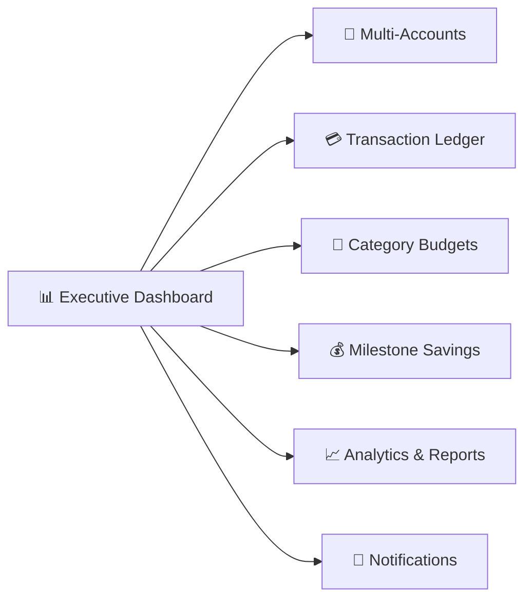

# FINORA – Personal Finance Intelligence

<p align="center">
  
</p>

<p align="center">
  <strong>Track Smarter. Spend Better. Grow Wealth.</strong>
</p>

<p align="center">
  <a href="https://github.com/danishalipny-pixel/FINORA/actions"></a>
  <a href="https://php.net"></a>
  <a href="https://www.mysql.com/"></a>
  <a href="https://www.php-fig.org/psr/psr-12/"></a>
  <a href="LICENSE"></a>
  <a href="https://github.com/danishalipny-pixel"></a>
</p>

---

## 📌 Executive Summary

**FINORA** is an enterprise-grade, high-performance Personal Finance Management Web Application engineered in pure **Core PHP (8.2+)** and **MySQL 8.0+** without the opacity or overhead of monolithic web frameworks. Built with a commercial fintech SaaS aesthetic, FINORA empowers users to achieve total clarity over multi-account liquidity, monthly cash flow, category budgets, milestone savings targets, and financial analytics.

This project demonstrates software engineering rigor, including parameterized regex routing, defensive validation layers, strict multi-tenant data isolation, atomic database transactions, fixed-point monetary precision (`DECIMAL(15,2)`), automated migrations, and a comprehensive 70-assertion automated test suite.

---

## 📑 Technical Documentation Index

For in-depth architectural and operational specifications, consult the dedicated documentation suite:

- 🏛️ **[System Architecture](docs/ARCHITECTURE.md)**: MVC topology, request lifecycle, service layer, and component diagrams.
- 🗄️ **[Database Architecture](docs/DATABASE.md)**: Entity-Relationship diagram, data dictionary, indexing, and precision rationale.
- 🚀 **[Installation & Deployment](docs/INSTALLATION.md)**: Setup guides for Windows/XAMPP, Linux/Nginx/Apache, and Docker.
- 🛡️ **[Security Architecture](docs/SECURITY.md)**: OWASP Top 10 mitigations, CSRF mechanics, bcrypt parameters, and rate limiting.
- 🧪 **[Testing & Quality Assurance](docs/TESTING.md)**: Unit, integration, feature test suites, and CI/CD automation.
- 🎨 **[UI Tour & Design System](docs/SCREENSHOTS.md)**: Visual walkthrough of all 17 screens and design system tokens.
- 🤝 **[Contributing Guidelines](CONTRIBUTING.md)**: GitFlow branching model, Conventional Commits, and code standards.

---

## 🌟 Core Functional Capabilities



### 1. Executive Financial Dashboard
- **Real-Time KPIs**: Total Reconciled Net Balance, Monthly Income, Monthly Burn Rate, and Accumulated Savings.
- **Interactive Visualizations**: 6-month historical cash flow trajectory (Line chart) and category expense distribution (Doughnut chart) powered by Chart.js.
- **Aggregated Widgets**: Quick access to recent transactions, active budget meters, and milestone savings progress.

### 2. Double-Entry Multi-Account Management
- Support for Checking Accounts, High-Yield Savings, Physical Cash Wallets, and Investment Reserves.
- Real-time balance reconciliation computing:
  $$\text{Current Balance} = \text{Opening Balance} + \text{Income} - \text{Expenses} - \text{Transfers Out} + \text{Transfers In}$$
- Soft-archiving and transactional deletion safeguards.

### 3. Transaction Management & Auditing
- Full CRUD tracking for Income, Expenses, and Inter-Account Transfers.
- Multi-criteria filtering by transaction type, category, account, date range, and full-text search.
- RFC-4180 compliant CSV export and bank statement bulk import.

### 4. Automated Category Budgeting & Overspending Alerts
- Monthly expense limits per category with three visual warning thresholds:
  - **Normal (`< 80%`)**: Green indicator showing healthy burn rate.
  - **Warning (`80% - 100%`)**: Amber alert warning of impending threshold violation.
  - **Exceeded (`> 100%`)**: Red alert highlighting overspending with over-budget differential.

### 5. Milestone Savings Goals & Contribution Tracking
- Goal accumulation with dedicated deposit ledgers, target dates, and automated days-remaining countdowns.
- Automatic milestone celebrations when goals reach 100% funded.

### 6. Comprehensive Financial Reporting & Print Engine
- Configurable reporting windows: Daily, Weekly, Monthly, Yearly, and Custom Date Ranges.
- Breakdown of expenditures by category with transaction frequency and percentage of total spend.
- Print-optimized view formatted for physical statements and PDF document generation.

### 7. Dual Theme & Localization
- **Theme Engine**: Light Mode (Fintech Clean) and Dark Mode (Midnight Navy).
- **Localization**: Native PKR (`Rs.`) formatting with configurable currency symbols, date masks, and Asia/Karachi timezone.

---

## 🛠️ Technology Stack

| Layer | Component | Description |
|---|---|---|
| **Backend Core** | PHP 8.2+ | Strict types (`declare(strict_types=1)`), OOP MVC pattern |
| **Database** | MySQL 8.0+ | InnoDB storage engine, foreign keys, `utf8mb4` charset |
| **Data Access** | PDO Singleton | 100% prepared statements with parameter binding |
| **Precision Math** | `DECIMAL(15,2)` | Elimination of IEEE 754 floating-point rounding errors |
| **Frontend UI** | HTML5 / CSS3 / Vanilla JS | Bootstrap 5.3, Bootstrap Icons, responsive layout |
| **Visual Charts** | Chart.js 4.4 | Responsive, theme-aware financial data visualizations |
| **Dependencies** | Composer | PSR-4 autoloader, PHPMailer, Dompdf |
| **Continuous Integration**| GitHub Actions | Automated linting, migrations, seeders, and tests |

---

## 🚀 Quickstart Guide

### 1. Prerequisites
- PHP 8.2 or newer with extensions: `pdo_mysql`, `mbstring`, `json`, `curl`.
- MySQL 8.0+ running locally or in Docker.

### 2. Clone & Configure
```bash
git clone https://github.com/danishalipny-pixel/FINORA.git
cd FINORA
cp .env.example .env
```

Review database credentials in `.env`:
```ini
DB_HOST=127.0.0.1
DB_PORT=3306
DB_DATABASE=finora_db
DB_USERNAME=root
DB_PASSWORD=
```

### 3. Run Migrations & Seed Demo Profile
```bash
# Execute schema migrations
php database/migrations/migrate.php

# Seed comprehensive demo account
php database/seeders/DatabaseSeeder.php
```

### 4. Launch Development Server
```bash
php -S 127.0.0.1:8080 -t public public/router.php
```
Visit **`http://127.0.0.1:8080`** in your browser.

### 5. Demo Credentials
| Role | Email | Password |
|---|---|---|
| **Demo User** | `demo@finora.test` | `FinoraDemo123!` |

---

## 🧪 Automated Testing Suite

FINORA features an automated test runner executing **70 passing assertions** across all layers of the architecture:

```bash
php tests/run_tests.php
```

```text
======================================================
       FINORA FINANCIAL SUITE - AUTOMATED TESTS       
======================================================

Running: PHP Syntax Linting across all project files...
  [PASS] All 101 PHP files have valid syntax without errors.

Running: UNIT TEST SUITE (Validators, CSRF, Balances, Bcrypt)
  [PASS] All 18 unit tests passed.

Running: INTEGRATION TEST SUITE (CRUD, Budgets, Savings)
  [PASS] All 10 integration tests passed.

Running: FEATURE TEST SUITE (Auth, Analytics, Reports, Routing)
  [PASS] All 30 feature tests passed.

Running: SYSTEM INTEGRITY & DATABASE VALIDATION
  [PASS] All 12 schema and table validations passed.

======================================================
TEST SUITE SUMMARY:
Passed:   70
Failed:   0
Duration: 14.9s
======================================================
ALL TESTS PASSED SUCCESSFULLY! (100% Verification Complete)
```

---

## 🛡️ Security Architecture

FINORA implements defense-in-depth principles:

- **SQL Injection Prevention**: 100% of queries use PDO prepared statements. Native string concatenation is strictly prohibited.
- **CSRF Defense**: State-changing requests enforce 64-character cryptographic tokens validated using constant-time `hash_equals()`.
- **Password Security**: Credentials hashed using `bcrypt` (cost factor 12). Plaintext secrets are never stored or returned in sessions.
- **Brute-Force Rate Limiting**: Accounts are locked out for 15 minutes after 5 consecutive failed login attempts.
- **Multi-Tenant Scoping**: Every database lookup, mutation, and aggregation is scoped to `user_id = ?` from the authenticated session.
- **XSS Mitigation**: Context-aware output escaping via `SecurityHelper::escape()` (`htmlspecialchars` with `ENT_QUOTES`).

---

## 📁 Project Architecture

```text
FINORA/
├── .github/workflows/         # Continuous Integration workflow
├── app/
│   ├── Controllers/           # HTTP controllers (12 controllers)
│   ├── Core/                  # Router, Database, Session, View, Csrf engines
│   ├── Helpers/               # FormatHelper, DateHelper, SecurityHelper
│   ├── Middleware/            # Auth, Guest, Csrf request interceptors
│   ├── Models/                # Tenant-scoped database query models
│   ├── Services/              # Analytics, Export, Notification services
│   └── Validators/            # Transaction, Budget, Account, Auth validators
├── bootstrap/app.php          # Application bootstrap & PSR-4 autoloader
├── config/                    # Application and database configuration
├── database/
│   ├── migrations/            # Granular SQL migrations and migrate.php runner
│   └── seeders/               # Category & Demo profile seeders
├── docs/                      # ARCHITECTURE, DATABASE, INSTALLATION, SECURITY, TESTING, SCREENSHOTS
├── public/                    # Assets (CSS, JS, Icons, Images), index.php, router.php
├── resources/views/           # Blade-style modular PHP views and components
├── routes/web.php             # Declarative route definitions
├── storage/                   # Logs, cache, uploads
└── tests/                     # Unit, Integration, and Feature test suites
```

---

## 👨‍💻 Author

**Danish Ali**  
- **GitHub:** [@danishalipny-pixel](https://github.com/danishalipny-pixel)  
- **Project Repository:** [FINORA – Personal Finance Intelligence](https://github.com/danishalipny-pixel/FINORA)

---

## 📄 License

This software is released under the **MIT License**. See [LICENSE](LICENSE) for terms.
