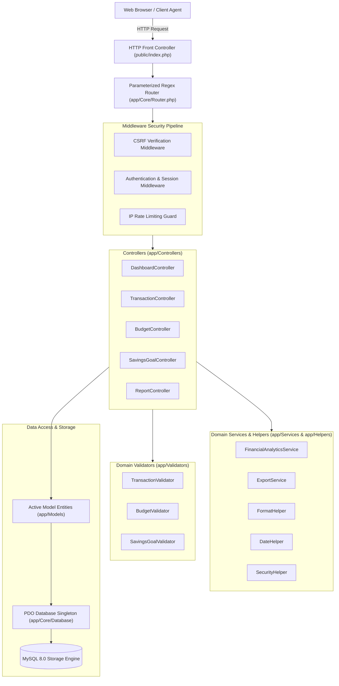
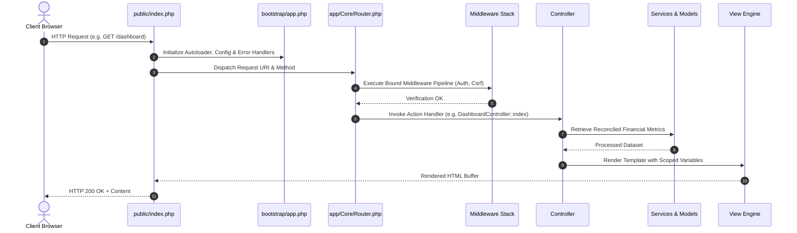

# FINORA System Architecture & Engineering Design

This document details the architectural design, layered structure, data flow, and runtime mechanics of **FINORA – Personal Finance Intelligence**.

---

## 1. Architectural Philosophy

FINORA is architected as an enterprise-grade, high-performance MVC application implemented in pure **PHP 8.2+** without the overhead or opacity of monolithic web frameworks. The core design principles are:

1. **Separation of Concerns (SoC)**: Presentation, business logic, domain validation, data access, and HTTP handling are strictly decoupled.
2. **Defensive Security by Default**: Zero-trust approach to client inputs, utilizing strict parameter typing, prepared statements, CSRF verification tokens, rate-limiting, and escaping.
3. **Explicit Request Lifecycle**: Transparent routing and middleware execution pipeline that provides microsecond-level dispatch latency.
4. **Idempotent Storage & Migrations**: Declarative database migrations with an integrated state-tracking table and transactional execution.

---

## 2. High-Level Component Diagram



---

## 3. Directory Structure

```text
FINORA/
├── .github/
│   └── workflows/
│       └── php-ci.yml                 # Automated Continuous Integration pipeline
├── app/
│   ├── Controllers/                   # HTTP action handlers (12 controllers)
│   ├── Core/                          # Core framework engines (Auth, Database, Router, View, etc.)
│   ├── Helpers/                       # OOP utilities (FormatHelper, DateHelper, SecurityHelper)
│   ├── Middleware/                    # Request interception (Auth, Guest, Csrf)
│   ├── Models/                        # Domain entities and SQL aggregation logic
│   ├── Services/                      # Analytics, Export, and Notification services
│   ├── Validators/                    # Dedicated business payload validators
│   ├── bootstrap.php                  # Legacy/submodule forwarder
│   └── helpers.php                    # Global view templating functions
├── bootstrap/
│   └── app.php                        # Framework initialization & autoloader registration
├── config/
│   ├── app.php                        # Application metadata, security rules, and locale
│   └── database.php                   # MySQL connection credentials and PDO options
├── database/
│   ├── migrations/                    # 10 granular DDL migrations & CLI migration runner
│   ├── seeders/                       # Reusable category & demo profile seeders
│   ├── database.sql                   # Monolithic fallback schema
│   └── seed.php                       # Root seeding entrypoint
├── docs/                              # Comprehensive technical documentation
│   ├── ARCHITECTURE.md                # System topology and design patterns
│   ├── DATABASE.md                    # ER diagram and schema data dictionary
│   ├── INSTALLATION.md                # Setup guide across Windows, Linux, and Docker
│   ├── SECURITY.md                    # Threat modeling and OWASP defense audit
│   ├── TESTING.md                     # QA test suites and execution instructions
│   └── SCREENSHOTS.md                 # UI design system and screen previews
├── public/
│   ├── assets/
│   │   ├── css/                       # Finora custom design system & dark mode tokens
│   │   ├── js/                        # Vanilla JS dynamic interactions & Chart.js logic
│   │   ├── icons/                     # Vector SVG finance glyphs
│   │   └── images/                    # Brand logos and vector visual assets
│   ├── .htaccess                      # Production Apache rewrite rules
│   ├── index.php                      # Single Front Controller entrypoint
│   └── router.php                     # Development server router for built-in PHP server
├── resources/
│   └── views/                         # Modular presentation layer
│       ├── accounts/                  # Account management & ledger views
│       ├── auth/                      # Login, Register, Forgot Password
│       ├── budgets/                   # Category budget cards and limits
│       ├── components/                # Reusable KPI cards, badges, alerts, empty states
│       ├── dashboard/                 # Financial metrics, cash flow charts, summaries
│       ├── errors/                    # 404 Not Found & 500 Server Error templates
│       ├── layouts/                   # App master layout & Auth standalone layout
│       ├── notifications/             # System and alert notification feeds
│       ├── profile/                   # User profile and security settings
│       ├── reports/                   # Monthly/yearly analytics and print templates
│       ├── savings/                   # Goals and contribution ledgers
│       ├── settings/                  # User preferences and currency settings
│       └── transactions/              # Transaction lists, modal forms, CSV imports
├── routes/
│   └── web.php                        # Central route declarations and middleware bindings
├── storage/
│   ├── cache/                         # Query caches and framework artifacts
│   ├── logs/                          # Error logs and security audit traces
│   └── uploads/                       # User profile avatars and attachments
├── tests/
│   ├── Feature/                       # End-to-end integration flows (Auth, Dashboard, Reports)
│   ├── Integration/                   # Repository CRUD and database aggregations
│   ├── Unit/                          # Isolated logic tests (Validators, CSRF, Balances)
│   └── run_tests.php                  # Master test runner with linting & integrity checks
├── .env.example                       # Environment template
├── .gitignore                         # Version control exclusions
├── composer.json                      # Dependency manifest and PSR-4 definitions
├── CONTRIBUTING.md                    # Open source collaboration and GitFlow rules
├── LICENSE                            # MIT License
├── phpunit.xml                        # PHPUnit test configuration
└── README.md                          # Comprehensive portfolio project showcase
```

---

## 4. Request Lifecycle & Routing

Every inbound HTTP request traverses through the following deterministic pipeline:



### Route Parameterization
The custom router uses dynamic regular expression compilation. Named URL patterns such as `/transactions/{id}/edit` are matched against incoming paths, extracting named arguments and injecting them directly into controller action signatures using PHP Reflection.

---

## 5. Service & Data Layer Architecture

### Active Model Pattern
Models in FINORA (`app/Models`) encapsulate:
- Static finder methods with parameterized SQL queries.
- Tenant scoping where `user_id` is always enforced as an explicit query predicate.
- Aggregate calculation queries (e.g., `Account::calculateBalance`, `Budget::getTotalBudgetSummary`).

### Dedicated Validation Layer
Domain validators (`app/Validators/`) encapsulate specific business validation rules separately from controller handlers:
- `TransactionValidator`: Validates positive decimal amounts, date validity, valid account ownership, and guards against transfer collisions.
- `BudgetValidator`: Enforces chronological validity between start and end dates and budget threshold limits.
- `AuthValidator`: Verifies password complexity, confirmation matching, and RFC email format.

### Reusable UI Components
Common UI artifacts are isolated in `resources/views/components/`:
- `kpi-card.php`: Standardized financial metric cards with dynamic trend badges and icons.
- `alert.php`: Dismissible alert banners for flash messaging.
- `badge.php`: Soft badge pills for status indicators.
- `empty-state.php`: Consistent empty state views when lists have no records.
