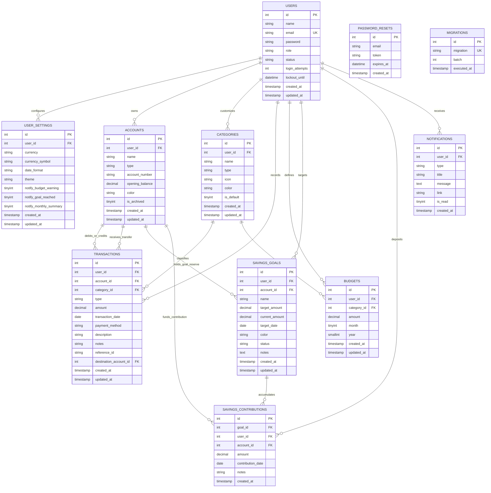

# FINORA Database Architecture & Schema Specification

This document provides a comprehensive technical overview of the relational database schema, data dictionary, indexing strategy, foreign key cascades, and monetary precision decisions powering **FINORA**.

---

## 1. Entity-Relationship (ER) Diagram

---

## 2. Monetary Precision Rationale: `DECIMAL(15, 2)`

In financial software, floating-point representations (`FLOAT`, `DOUBLE`) introduce IEEE 754 precision rounding errors that compound over time during iterative summations and aggregations.

FINORA mandates fixed-point numeric storage:
- **Column Type**: `DECIMAL(15, 2)`
- **Total Precision**: 15 digits total, with exactly 2 fractional digits reserved for sub-unit currency values (e.g., paisas/cents).
- **Maximum Value**: `9,999,999,999,999.99` (up to 9.99 Trillion PKR), fully accommodating institutional scale and hyper-inflated valuations without overflow risk.
- **Computation Guard**: All SQL aggregates employ `COALESCE(SUM(amount), 0.00)` to eliminate null propagation.

---

## 3. Data Dictionary

### 3.1. `users`
Stores primary user identity credentials and account state.

| Column | Type | Nullable | Constraints / Default | Description |
|---|---|---|---|---|
| `id` | `INT UNSIGNED` | No | `AUTO_INCREMENT, PRIMARY KEY` | Unique user identifier |
| `name` | `VARCHAR(100)` | No | - | User full legal or display name |
| `email` | `VARCHAR(191)` | No | `UNIQUE` | Unique email for authentication |
| `password` | `VARCHAR(255)` | No | - | Bcrypt password hash |
| `avatar` | `VARCHAR(255)` | Yes | `DEFAULT NULL` | Path to uploaded profile image |
| `role` | `ENUM('user', 'admin')` | No | `DEFAULT 'user'` | Access control role |
| `status` | `ENUM('active', 'inactive', 'suspended')` | No | `DEFAULT 'active'` | Operational account status |
| `login_attempts` | `INT` | No | `DEFAULT 0` | Failed attempts counter |
| `lockout_until` | `DATETIME` | Yes | `DEFAULT NULL` | Lockout expiration timestamp |
| `created_at` | `TIMESTAMP` | No | `DEFAULT CURRENT_TIMESTAMP` | Record creation timestamp |
| `updated_at` | `TIMESTAMP` | No | `ON UPDATE CURRENT_TIMESTAMP` | Last modification timestamp |

### 3.2. `user_settings`
User-level localization preferences and notification toggles.

| Column | Type | Nullable | Constraints / Default | Description |
|---|---|---|---|---|
| `id` | `INT UNSIGNED` | No | `AUTO_INCREMENT, PRIMARY KEY` | Settings ID |
| `user_id` | `INT UNSIGNED` | No | `UNIQUE, FK -> users(id) ON DELETE CASCADE` | Associated user |
| `currency` | `VARCHAR(10)` | No | `DEFAULT 'PKR'` | ISO currency code |
| `currency_symbol`| `VARCHAR(10)` | No | `DEFAULT 'Rs.'` | Display symbol |
| `date_format` | `VARCHAR(20)` | No | `DEFAULT 'Y-m-d'` | Display date formatting mask |
| `theme` | `ENUM('light', 'dark')` | No | `DEFAULT 'light'` | UI theme preference |
| `notify_budget_warning` | `TINYINT(1)` | No | `DEFAULT 1` | Alert on 80% budget limit |
| `notify_goal_reached` | `TINYINT(1)` | No | `DEFAULT 1` | Alert on goal completion |
| `notify_monthly_summary` | `TINYINT(1)` | No | `DEFAULT 1` | Alert on monthly close |

### 3.3. `accounts`
Financial storage vehicles (bank accounts, savings accounts, cash wallets).

| Column | Type | Nullable | Constraints / Default | Description |
|---|---|---|---|---|
| `id` | `INT UNSIGNED` | No | `AUTO_INCREMENT, PRIMARY KEY` | Account ID |
| `user_id` | `INT UNSIGNED` | No | `FK -> users(id) ON DELETE CASCADE` | Account owner |
| `name` | `VARCHAR(100)` | No | - | Human-friendly name |
| `type` | `ENUM('cash','bank','savings','other')` | No | `DEFAULT 'bank'` | Vehicle categorization |
| `account_number` | `VARCHAR(50)` | Yes | `DEFAULT NULL` | Bank account number/IBAN |
| `opening_balance`| `DECIMAL(15,2)` | No | `DEFAULT 0.00` | Initial baseline balance |
| `color` | `VARCHAR(20)` | No | `DEFAULT '#10B981'` | Hex accent badge color |
| `is_archived` | `TINYINT(1)` | No | `DEFAULT 0` | Soft-hide toggle |

### 3.4. `transactions`
Double-entry compatible financial ledger tracking income, expense, and inter-account transfers.

| Column | Type | Nullable | Constraints / Default | Description |
|---|---|---|---|---|
| `id` | `INT UNSIGNED` | No | `AUTO_INCREMENT, PRIMARY KEY` | Transaction ID |
| `user_id` | `INT UNSIGNED` | No | `FK -> users(id) ON DELETE CASCADE` | Ledger owner |
| `account_id` | `INT UNSIGNED` | No | `FK -> accounts(id) ON DELETE RESTRICT` | Source account |
| `category_id` | `INT UNSIGNED` | Yes | `FK -> categories(id) ON DELETE SET NULL` | Budget classification |
| `type` | `ENUM('income','expense','transfer')` | No | - | Transaction nature |
| `amount` | `DECIMAL(15,2)` | No | - | Monetary value |
| `transaction_date` | `DATE` | No | - | Effective date |
| `payment_method` | `VARCHAR(50)` | No | `DEFAULT 'Cash'` | Method of settlement |
| `description` | `VARCHAR(255)` | No | - | Line-item description |
| `notes` | `TEXT` | Yes | `DEFAULT NULL` | Optional detailed context |
| `reference_id` | `VARCHAR(100)` | Yes | `DEFAULT NULL` | Bank receipt/slip number |
| `destination_account_id` | `INT UNSIGNED` | Yes | `FK -> accounts(id) ON DELETE SET NULL` | Target account for transfers |

---

## 4. Indexing & Query Optimization Strategy

The schema maintains index coverage targeting real-world query predicates:

1. **`idx_transactions_user_date` (`user_id`, `transaction_date`)**:
   Optimizes dashboard cashflow range scans and monthly report aggregations (`BETWEEN start_date AND end_date`).
2. **`idx_transactions_user_type` (`user_id`, `type`)**:
   Accelerates independent income vs. expense summation filters.
3. **`idx_accounts_user_archived` (`user_id`, `is_archived`)**:
   Ensures instantaneous balance computation retrieval without scanning archived records.
4. **`uk_user_category_month_year` (`user_id`, `category_id`, `month`, `year`)**:
   Strict unique composite index preventing duplicate budget lines for the same category in any given calendar month.
5. **`idx_password_resets_token` (`token`)**:
   Fast lookup for password reset recovery tokens.
