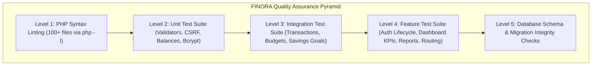

# FINORA Testing & Quality Assurance Methodology

This document outlines the testing strategy, test suites, automation harness, and verification standards ensuring the reliability of **FINORA – Personal Finance Intelligence**.

---

## 1. Quality Assurance Strategy

FINORA employs a multi-tiered automated testing pyramid designed to verify data integrity, financial math precision, security enforcement, and HTTP request routing.



---

## 2. Test Suite Breakdown

### 2.1. Level 1: PHP Syntax Linting
Iterates through all project PHP files (`app/`, `config/`, `routes/`, `resources/`, `database/`, `tests/`) executing `php -l` to identify syntax or syntax deprecation issues before runtime.

### 2.2. Level 2: Unit Tests (`tests/Unit/`)
- **`ValidatorTest.php`**: Validates core validation rules (`required`, `email`, `numeric`, `in`, `min`, `max`) and domain validators (`TransactionValidator`, `AccountValidator`, `BudgetValidator`, `SavingsGoalValidator`, `AuthValidator`).
- **`AccountBalanceTest.php`**: Verifies dynamic balance calculation algorithms across active bank accounts, savings accounts, and cash wallets.
- **`CsrfTest.php`**: Asserts generation of 64-character hexadecimal tokens, HTML hidden fields, and constant-time validation.
- **`PasswordSecurityTest.php`**: Verifies bcrypt hash generation (`$2y$`), cost factor parameters, and password verification.

### 2.3. Level 3: Integration Tests (`tests/Integration/`)
- **`TransactionRepositoryTest.php`**: Exercises full CRUD operations against live MySQL tables (`CREATE`, `READ`, `UPDATE`, `DELETE`) with user tenancy enforcement.
- **`BudgetCalculationTest.php`**: Reconciles monthly budget limits against actual expense line items and computes spent percentages.
- **`SavingsContributionTest.php`**: Asserts savings goal allocations, target dates, remaining days calculations, and progress percentages.

### 2.4. Level 4: Feature Tests (`tests/Feature/`)
- **`AuthenticationFlowTest.php`**: Verifies credential validation, rejection of invalid attempts, session payload population, and logout session destruction.
- **`DashboardAnalyticsTest.php`**: Tests aggregation of all 4 dashboard financial KPIs, 6-month cashflow historical trends, and category expense doughnut distributions.
- **`ReportGenerationTest.php`**: Validates monthly financial report calculations (`total_income - total_expense = net_savings`) and RFC-compliant CSV transaction exports.
- **`HttpRoutingTest.php`**: Validates route registry for all 17 primary application endpoints.

### 2.5. Level 5: System & Migration Integrity
Verifies MySQL connectivity, the existence of all 10 schema tables, the `migrations` tracking table, and foreign key relations.

---

## 3. Running Automated Tests

### 3.1. Master Test Suite Runner
Execute the master automated runner from the project root:
```bash
php tests/run_tests.php
```

Sample output:
```text
======================================================
       FINORA FINANCIAL SUITE - AUTOMATED TESTS       
======================================================

Running: PHP Syntax Linting across all project files...
  [PASS] All 101 PHP files have valid syntax without errors.

------------------------------------------------------
Running: UNIT TEST SUITE
------------------------------------------------------
 -> ValidatorTest:
  [PASS] Core Validator accepts valid payload
  [PASS] Core Validator rejects invalid email, negative amount, and invalid enum
  [PASS] TransactionValidator passes for valid income payload
  [PASS] TransactionValidator rejects transfer when source equals destination
  [PASS] AccountValidator passes for valid savings account
  [PASS] BudgetValidator passes for valid monthly budget
  [PASS] AuthValidator validates registration with password confirmation
 -> AccountBalanceTest:
  [PASS] Retrieved active accounts with reconciled balances
  [PASS] Account 'HBL - Roshan Digital Savings' reconciled balance is non-negative and valid numeric
  [PASS] Account 'Meezan Bank - Main Checking' reconciled balance is non-negative and valid numeric
  [PASS] Account 'Physical Cash Wallet' reconciled balance is non-negative and valid numeric
  [PASS] Account 'Standard Chartered Reserve' reconciled balance is non-negative and valid numeric
...
======================================================
TEST SUITE SUMMARY:
Passed:   70
Failed:   0
Duration: 14.9s
======================================================

ALL TESTS PASSED SUCCESSFULLY! (100% Verification Complete)
```

### 3.2. PHPUnit CLI
When PHPUnit is installed via Composer:
```bash
vendor/bin/phpunit
```

---

## 4. Continuous Integration Pipeline (GitHub Actions)

FINORA includes a GitHub Actions configuration at `.github/workflows/php-ci.yml`. On every push and pull request to `master` and `develop`:
1. Matrix tests across PHP **8.2** and **8.3**.
2. Launches an isolated MySQL 8.0 service container.
3. Validates `composer.json` syntax.
4. Executes database migrations via `php database/migrations/migrate.php`.
5. Runs the database seeder via `php database/seeders/DatabaseSeeder.php`.
6. Executes the master automated test suite via `php tests/run_tests.php`.
